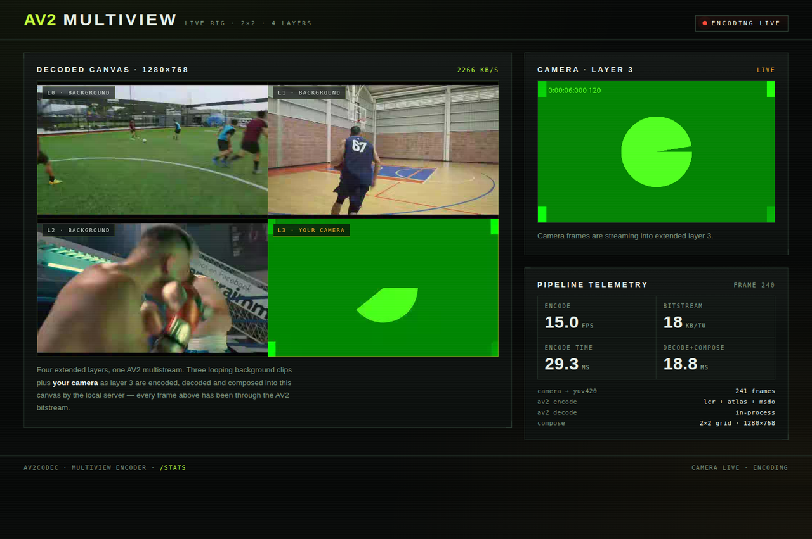

# Live camera multiview: browser camera into an AV2 multistream

A local web demo where the browser asks for camera access and streams the
camera into a 2x2 AV2 multiview canvas. The page, the encoder and the decoder
all run locally: the browser captures frames, a small Rust server encodes them
with `av2codec` as extended layer 3 next to three looping sports clips, decodes
the multistream again and composes the 1280x768 canvas that the page displays.

```sh
cargo build --release --bin av2codec_live
./target/release/av2codec_live --port 8090
# open http://localhost:8090/ and click "Enable camera"
```

`--fps` (default 15), `--qindex` (default 150) and `--background-dir` control
the pipeline. Background clips are taken from the sports demo output
(`target/demo/sports/clips/view_*.y4m`) when present, otherwise three synthetic
clips are generated with FFmpeg into `target/demo/live`.



## Architecture

```
browser                                   local server (av2codec_live)
───────                                   ────────────────────────────
getUserMedia ──► canvas 640x384
                ──► RGBA POST /frame ────► RGBA → YUV420
                                          ──► AV2 encode (4 layers, 2x2 atlas)
                                          ──► AV2 decode (in-process)
                                          ──► compose 1280x768 canvas
img src="/canvas.mjpg" ◄── MJPEG ◄──────── ffmpeg (mjpeg from raw yuv420p)
stats JSON /stats ◄─────────────────────── fps, timings, bitrate
```

Every displayed canvas frame has been through the AV2 bitstream: the server
builds one temporal unit per iteration with `encode_multiview_with_threads`,
decodes that unit with `av2codec::Decoder`, and only then composes the four
layers into the canvas. The camera is simply another extended layer, so it is
described by the same LCR/atlas metadata as the background clips.

## Measured on the demo machine

| Metric | Value |
|---|---|
| canvas | 1280x768, four 640x384 layers, 15 fps |
| encode | ~28-29 ms per temporal unit (4 threads) |
| decode + compose | ~18-19 ms per temporal unit |
| bitstream | 16-18 KB per temporal unit, ~2.0-2.3 Mbit/s at qindex 150 |
| camera transport | 640x384 RGBA POST per frame (~983 KB), 15 fps |
| end-to-end | 15.0 fps sustained, ~47-49 ms of the 66 ms frame budget |

The page shows the same numbers live in its telemetry panel. Encoding fits the
15 fps budget with roughly 25% headroom; the loop is paced to the target rate,
so transient slowdowns show up as a lower fps reading rather than drift.

## Notes and limitations

- The camera API requires a secure context: use `http://localhost:<port>` (or
  `127.0.0.1`). Opening the page through a LAN address will make
  `getUserMedia` unavailable.
- The browser sends raw RGBA over loopback and the server converts to YUV420;
  no image codec is needed on the input path. The output preview is MJPEG,
  encoded by FFmpeg from the composed YUV420 canvas.
- Decoding in the live loop uses av2codec's own decoder. The offline demos
  ([stereo/conference](2026-10-18-multiview-encoder-demo.md),
  [sports wall](2026-10-18-sports-multiview-demo.md)) validate the same
  bitstream shape against the reference `avmdec`.
- One camera is mapped to layer 3. Additional camera devices could fill the
  remaining layers by capturing them in the page and posting them with a layer
  index; the server-side layout is driven by the `MultiviewConfig` view list.
- Layer geometry is fixed at 640x384 per view because the encoder pads to
  superblock multiples; arbitrary camera aspect ratios are cropped to 5:3 in the
  browser before sending.
- `?autostart=1` starts the camera without the button click; this is what the
  automated screenshot used together with Chrome's
  `--use-fake-device-for-media-stream --use-fake-ui-for-media-stream` flags.
