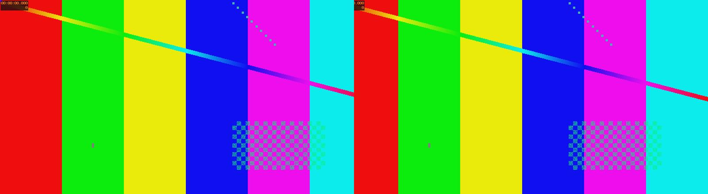
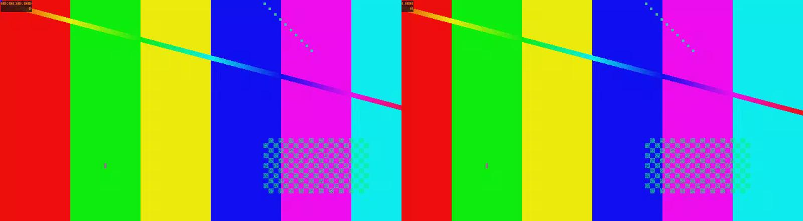
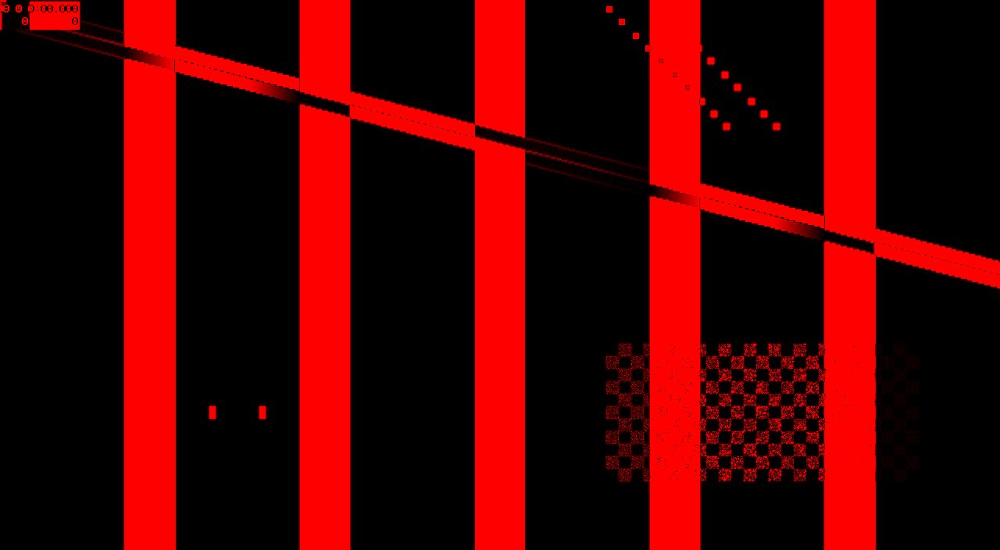
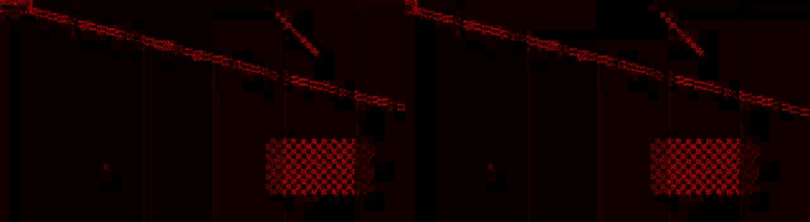
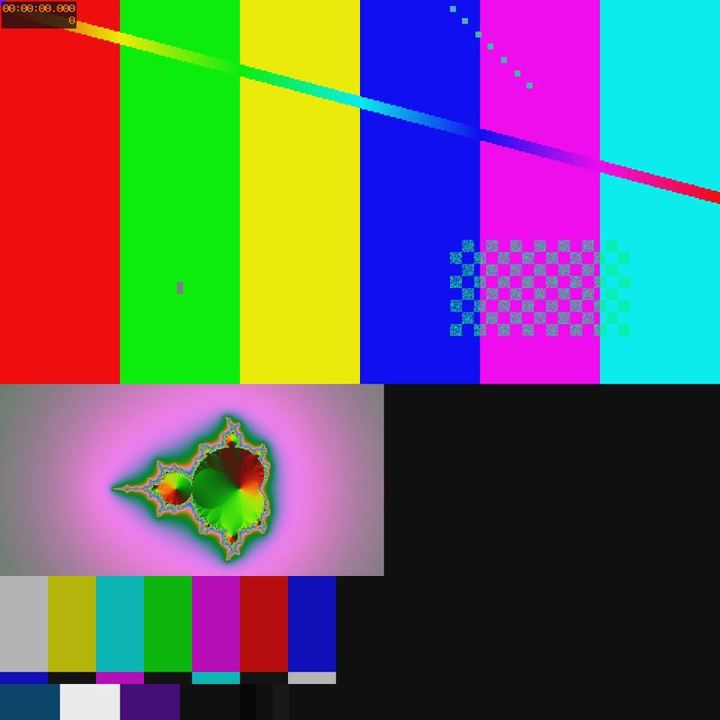

# Multiview encoder demo: av2codec encodes, avmdec decodes

End-to-end demonstration of the multiview encoder added in `60edc44`. The demo
synthesizes two scenarios with FFmpeg, encodes one AV2 multistream bitstream per
scenario with `av2codec --multiview`, decodes every extended layer with the
reference decoder (`avmdec --num-streams=N`) and verifies the result.

Run it with:

```sh
cargo build --release --bin av2codec
python3 demos/native/multiview_demo.py --sweep
```

The script writes bitstreams, per-layer decodes, PNG snapshots and a
`summary.md` to `target/demo/multiview`. It needs `ffmpeg` and `avmdec`
(`AVMDEC`/`--avmdec` override); `dav2d` is used when present.

## Scenarios

| Scenario | Views | Atlas |
|---|---|---|
| Stereoscopic pair | 2 x 1280x704, 64 px horizontal disparity, 3 frames | row, 2560x704 |
| Conference layout | 960x512 + 512x256 + 448x192, 3 frames | column, 960x960 |

Both view sizes are multiples of 64, so the encoder's superblock padding does
not change the decoded geometry (that is why 704, 512, 256 and 192 were chosen).

## Results

First temporal unit of the lossless stereo bitstream, as the encoder emits it:

| OBU | tlayer | mlayer | xlayer | bytes |
|---|---|---|---|---|
| TD | 0 | 0 | 31 | 1 |
| MSDO | 0 | 0 | 31 | 8 |
| LCR | 0 | 0 | 31 | 40 |
| ATLAS | 0 | 0 | 31 | 12 |
| LCR | 0 | 0 | 0 | 18 |
| SEQ | 0 | 0 | 0 | 20 |
| CLK | 0 | 0 | 0 | 61878 |

Checks (stock `avmdec`):

| Check | Result |
|---|---|
| stereo, qindex 0 | bit-exact per view |
| stereo, qindex 150 | 39.30 dB / 39.32 dB per view |
| conference, qindex 150 | 38.88 dB / 35.73 dB / 50.48 dB |
| extracted layer 1 | identical to the layer decode of the multistream |
| dav2d on the extracted layer | decodes bit-exactly |
| atlas canvases | stereo 2560x704, conference 960x960 |

Bitstream sizes:

| Bitstream | Bytes |
|---|---|
| stereo, qindex 0 | 371399 |
| stereo, qindex 150 | 67859 |
| conference, qindex 150 | 34525 |
| extracted layer 1 | 33723 |

Quality sweep for the left view (three frames, single stream), showing the
encoder's qindex range:

| qindex | bytes | PSNR |
|---|---|---|
| 0 | 186676 | lossless |
| 100 | 88417 | 50.69 dB |
| 150 | 34016 | 39.30 dB |
| 200 | 7354 | 33.10 dB |
| 255 | 2664 | 24.77 dB |

## Visuals

The two views of the stereoscopic pair as encoded into the row atlas
(source, 2560x704 reduced to 1600 px wide):



After `avmdec --num-streams=2` at qindex 150:



The views are genuinely different; amplifying the horizontal disparity between
the two source views shows the displaced edges:



Compression error at qindex 150 (absolute difference against the source,
amplified 8x) sits on the high-frequency edges, as expected for a DCT codec
without in-loop filters:



The three-view conference layout decodes as three independent extended layers;
the encoder's column atlas is 960x960 and pads the narrower views with the
default background colour:




## Notes

- `dav2d` cannot split a multistream: it ignores LCR/atlas/MSDO and emits every
  layer as a consecutive frame. It does decode the extracted singlestream
  (`av2codec ... --extract-layer 1`) bit-exactly, which is the intended way to
  play one view with decoders that do not implement layers.
- `avmdec` is the only reference decoder that can validate per-view output; the
  comparison is against the source planes at qindex 0 and against PSNR at
  qindex 150.
- Multiview composition (Annex D) is not implemented in either av2codec or the
  reference decoder. The atlas images here are reconstructed from the encoder's
  declared layout, which is what a renderer would do.
