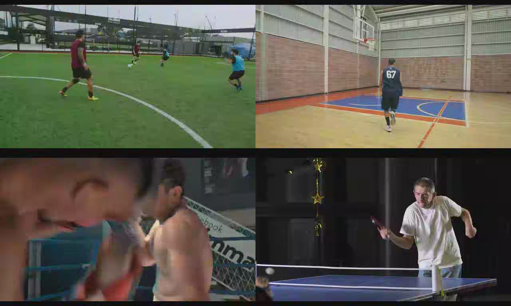
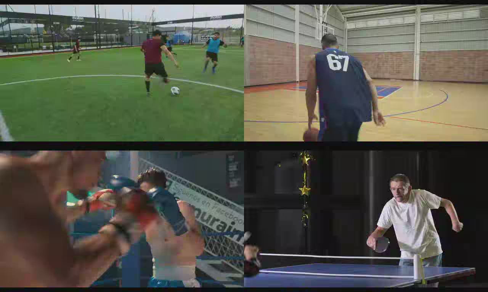
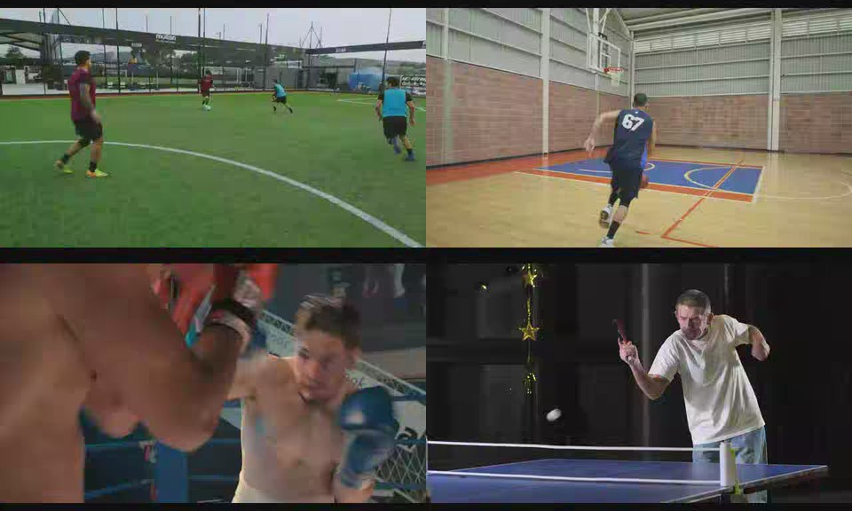

# Sports multiview wall: four clips, one AV2 multistream

Demonstration of the multiview encoder on real sports footage: four independent
clips are encoded as four extended layers of one AV2 multistream, decoded
together with `avmdec`, and composed into the 1280x768 frame canvas declared by
the encoder's 2x2 atlas grid. This is the "play the multiview as one canvas"
path, not per-view extraction.

Run it with:

```sh
cargo build --release --bin av2codec
python3 tools/sports_multiview_demo.py
```

The demo downloads four short clips (Mixkit Free License), letterboxes them to
640x384 at 15 fps, encodes 5 seconds per view, decodes all four layers, writes
`sports_multiview.mp4` (1280x768, 15 fps), a GIF preview and PNG stills to
`target/demo/sports`, and prints the numbers below. To use your own footage,
drop files named `soccer_source.mp4` etc. into `target/demo/sports/clips` and
pass `--skip-download`, or edit the `CLIPS` table in the script.

## Result

| Metric | Value |
|---|---|
| views | 4 x 640x384, 15 fps, 5 s (75 temporal units) |
| atlas | 2x2 grid, 1280x768 canvas |
| bitstream | 1,558,085 bytes (~2.5 Mbit/s) |
| encode, 1 thread | 9.6 multiview fps |
| encode, 4 threads | **34.4 multiview fps** |
| `avmdec` decode | 0.73 s for 75 canvas frames |
| canvas composition | 0.08 s |
| decode + compose | **92.6 canvas fps** |
| PSNR at qindex 150 | soccer 34.92 dB, basketball 35.66 dB, boxing 36.92 dB, table tennis 37.33 dB |

The composed canvas, decoded from the four extended layers:



An earlier instant of the same stream:



The four decoded layers, each a normal AV2 sequence inside the multistream:



The bitstream has the expected multiview shape: one temporal delimiter and
MSDO per unit, the global LCR and atlas in the global layer context, then one
coded extended layer unit per clip in ascending `obu_xlayer_id` order, each with
its local LCR, sequence header and CLK frame.

## Realtime encoding

Everything is intra-only, so encode cost is constant per frame and independent
of motion. Views are encoded in parallel threads (the CLI defaults to one thread
per view); output is byte-identical to the single-threaded encoding. Measured on
an AMD Ryzen 9 7900X (12 cores / 24 threads), qindex 150:

| Configuration | 1 thread | N threads | Real time at 15 fps |
|---|---|---|---|
| 4 x 640x384 | 9.9 fps | 35.6 fps | 2.4x |
| 4 x 960x512 | 5.1 fps | 18.5 fps | 1.2x |
| 2 x 960x512 | 10.1 fps | 19.0 fps | 1.3x |
| 2 x 1280x704 | 5.5 fps | 10.0 fps | 0.7x |

So yes: 15 fps multiview encoding is realtime for a 2x2 wall of 640x384 views
and for four 960x512 views on this machine, with per-view parallelism bounded by
the number of views. 1280x704 stereo is below realtime with this encoder
(10 fps); scaling further would need superblock-level parallelism inside a view.

Decoding is not the bottleneck: `avmdec` plus canvas composition runs at ~93
canvas fps, and playback of the produced MP4 is trivial.

## Live camera variant

The same 2x2 wall, with the user's camera as layer 3, runs as a local web page
([live camera multiview](2026-10-18-live-camera-multiview-demo.md)): the browser
posts camera frames, the server encodes/decodes/composes them with the three
sports clips and streams the canvas back as MJPEG.

## Notes

- The canvas composition here is the renderer step (background fill plus
  segment placement, the informative Annex D/G behaviour); `avmdec` itself
  returns one frame sequence per extended layer, not a composed canvas.
- The encoder emits the layout metadata (enhanced atlas with a 2x2 region grid,
  one region per segment, per-layer `lcr_layer_atlas_segment_id`) so a player or
  renderer can reproduce the canvas without side information.
- Clips are from [Mixkit](https://mixkit.co/) under the
  [Mixkit Free License](https://mixkit.co/license/): free for use in projects,
  including commercial ones. The demo re-downloads them at run time; the
  repository only stores stills for this report.
- The bitstreams are still intra-only, which is why 5 seconds of four 640x384
  views costs ~1.6 MB at qindex 150; inter prediction and rate control remain
  future work.
